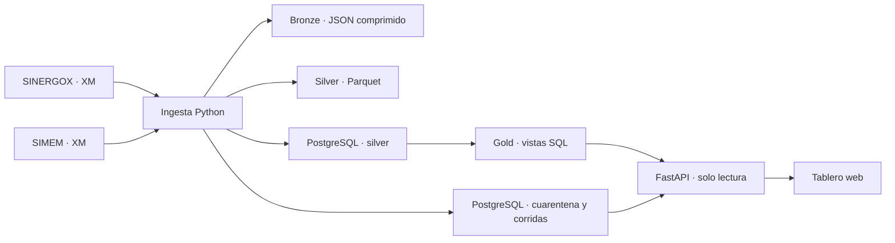

# Pulso Eléctrico Colombia

Plataforma de datos del Sistema Interconectado Nacional para explorar precios de bolsa, demanda, embalses y generación. La demo reúne el análisis de mercado y el estado de las cargas en una sola aplicación.



## Inicio local

1. Copia `.env.example` a `.env` y asigna tres contraseñas distintas. La API usa exclusivamente `market_reader`.
2. Ejecuta `docker compose up --build -d`.
3. Ejecuta la primera carga. Ejemplo histórico reproducible de 30 días:

   ```sh
   docker compose exec pipeline python pipeline.py --start 2026-10-01 --end 2026-10-30
   ```

4. Abre [el tablero](http://localhost:8000/), [la API](http://localhost:8000/docs) o [la demo de octubre](http://localhost:8000/?start=2026-10-01&end=2026-10-30). El filtro por defecto muestra los últimos 30 días, así que para una carga histórica también puedes elegir el rango manualmente.

## Fuentes y significado

| Métrica | Fuente e ID | Grano de origen | Unidad del tablero |
|---|---|---|---|
| Precio de bolsa nacional | XM · `PrecBolsNaci` · Sistema | Hora | COP/kWh, media aritmética diaria |
| Demanda real del SIN | XM · `DemaReal` · Sistema | Hora | GWh, suma de las 24 horas |
| Volumen útil del SIN | XM · `PorcVoluUtilDiar` · Sistema | Día | Porcentaje, fracción de origen × 100 |
| Generación real estimada | SIMEM · `E17D25` | Día y planta | GWh, agrupados por tecnología |

Los tres IDs de SINERGOX se validan consultando `ReadDB().get_collections()` de pydataxm. La ingesta hace las solicitudes directamente para preservar los cuerpos originales. Referencia: [API de XM y SIMEM](https://github.com/EquipoAnaliticaXM/API_XM).

La hora 01 de XM representa el inicio de la primera franja del día (00:00 de Colombia). El tablero calcula Pearson con los pares de fechas disponibles. La regla de picos compara cada precio con el tercer cuartil más 1,5 veces el rango intercuartílico para su hora en la ventana seleccionada. La clasificación renovable incluye hidráulica, solar y eólica. La cogeneración y las tecnologías sin clasificación explícita aparecen en «Otras».


## Operación y recuperación

- El proceso comprueba cada minuto si corresponde la corrida de las 13:00 de Colombia. Cada día vuelve a consultar los últimos siete días para incorporar publicaciones tardías. Reiniciar el contenedor después de las 13:00 puede repetir la corrida del día.
- Las consultas SINERGOX se dividen en ventanas inclusivas de hasta 30 días. SIMEM se solicita por día para limitar el tamaño de respuesta. Las fallas transitorias reintentan con espera creciente.
- Los días válidos se reemplazan transaccionalmente por métrica. Los inválidos quedan registrados en `ops.quarantine` y preservan la última versión válida. La clave primaria impide duplicados y un bloqueo PostgreSQL impide cargas concurrentes.
- Bronze guarda el cuerpo de cada respuesta. Silver conserva Parquet por métrica, día y corrida. El `run_id` de `silver.observation` identifica el archivo vigente. Los archivos de corridas fallidas o reemplazadas sirven para investigar y ocupan espacio adicional.
- Revisa la vista Operación y `docker compose logs --tail 100 pipeline`. Para recuperar una ventana, ejecuta el comando de carga con `--start`, `--end` y, opcionalmente, `--metric price`, `demand`, `reservoir` o `generation`. El comando manual devuelve código distinto de cero si hay días rechazados.
- Respalda PostgreSQL y el volumen del lago antes de mover o eliminar datos. Los límites de plausibilidad en `metrics.yml` son reglas operativas ajustables. Investiga un rechazo antes de cambiar sus umbrales.

## Laboratorios fuera de la VPS

- **Spark.** `spark-submit lab/spark/normalize_xm.py archivo-horario.json.gz salida.parquet` hace el unpivot de un bronze horario con PySpark 3.5+. Úsalo con una respuesta válida de precio o demanda. El pipeline principal hace la misma operación en Python y escribe Parquet con PyArrow.
- **Airflow 3.** Copia `lab/airflow/energy_daily.py` al directorio de DAGs de un entorno aparte. Instala las dependencias del proyecto en el worker y pon el repositorio en su ruta de importación. Configura las variables de conexión del rol de carga y un volumen persistente para el lago. Si usas el DAG como orquestador, desactiva el programador de Compose.
- **dbt.** Con `dbt-postgres` y una conexión autorizada para crear vistas en el esquema `analytics` y leer `gold`, ejecuta `dbt build --project-dir lab/dbt --profiles-dir lab/dbt`. El modelo agrega el mercado semanal y verifica la clave de fecha.

## Verificación

```sh
python -m pip install -r requirements.txt
python -m unittest -v
docker compose config --quiet
```

GitHub Actions ejecuta las pruebas del extractor y construye la imagen. El diseño inicial usa volúmenes locales y vistas SQL con el índice compuesto de observaciones. MinIO, Terraform, Kafka, Kubernetes, particiones físicas y alertas externas quedan fuera de esta versión. Mide `EXPLAIN (ANALYZE, BUFFERS)` con el histórico cargado antes de decidir qué optimizar.
